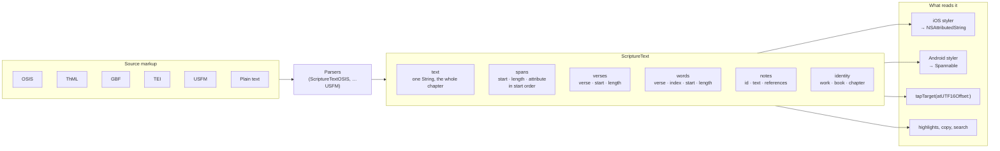
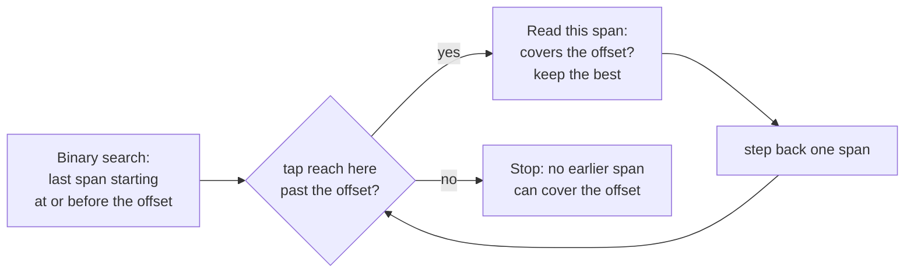
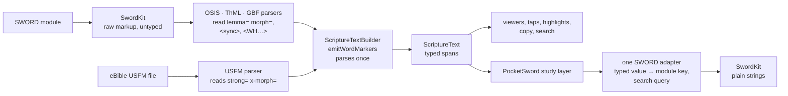

# The scripture text model

`ScriptureText` (`Sources/ScriptureText/Model/ScriptureText.swift`) is what every parser produces and what both viewers draw: a
chapter of a Bible or commentary, a dictionary entry, a devotional day. This file explains its shape, the rules it keeps, why it is
built this way, and what could still change. The viewer's inputs and events are in [ScriptureViewerContract.md](ScriptureViewerContract.md).

## The shape: one string and labelled ranges



A short example: the start of Psalm 119 in the KJV, with Strong's markers shown (the offsets are illustrative).

```
text:   ¹Blessed<H835> are the undefiled in the way …
        0123456789…

spans:  start  length  attribute
        0      1       verseNumber(1)
        1      7       word(lemma: "strong:H835", morph: nil)
        8      6       strongs("strong:H835")        ← the visible <H835> marker
        …

verses: verse 1, start 0, length 95 …
words:  (verse 1, index 0, start 1, length 7) …
notes:  (none in this verse)
```

- **`text`** is plain: no markup, no styling. Paragraphs are separated by `\n`.
- **`spans`** label ranges of `text` with what they *are*: a verse number, red letter, small text, bold, italic, a Strong's or
  morphology marker, a word with its lemma, a footnote marker, a link, a block with a paragraph role (heading, poetry line), the
  divine name.
- **`verses`** say where each verse (or bridge, `1-2`, or part, `14a`) lies in `text`.
- **`words`** anchor every word of canonical text to *(verse, index)*.
- **`notes`** hold footnote and cross-reference bodies; only their marker is in `text`.
- **`identity`** names the chapter, when the host gave it.

## The rules it keeps

1. **Offsets are UTF-16 code units.** This is the unit `NSString` and Kotlin's `String` index by, so an offset means the same
   character on both platforms. A character outside the Basic Multilingual Plane is two units, and nothing splits the pair.
2. **Spans carry meaning, never looks.** A span says *red letter* or *divine name*, never a colour or a font. Each platform's styler and
   theme decide how it looks, so night mode, fonts and accessibility sizes do not touch the model.
3. **Saved data keys on words, not offsets.** Turning on Strong's markers or a verse per line adds text and moves every offset after
   it. A highlight, a note or a selection is stored as *(verse, word index)*, which does not move.
4. **Notes live outside the text.** Copying and search do not meet footnote bodies; the marker in `text` points at the note by id.
5. **Everything is in start order.** `spans` are ordered by start, the longer first where two start together (an outer span before the
   spans inside it), and otherwise in the order they were given. `verses` and `words` are ordered by start; neither overlaps.
   The model keeps the spans in order itself: the initialiser orders them, and so does every assignment to `spans`, including
   `spans.append(…)`. The initialiser orders `verses` and `words`; code that changes them afterwards keeps the order (the model's own
   helpers, such as `prependingHeading`, do). `ScriptureText.isOrdered(_:)` checks a list of spans.

Rule 5 matters because some sources do not give spans in order. The ThML and TEI parsers record a span when its element closes, so an
outer span comes after the spans inside it; hosts that build a text by hand append as they go. Ordering is a single pass when the
spans are already in order, which is what the builder produces.

## Finding things by position

A tap gives the viewer a UTF-16 offset, and the model answers what is there: `tapTarget(atUTF16Offset:)`, with the verse and word
around it.

**Verses and words** never overlap and are in start order, so a binary search finds the one item that can hold the offset:
the last one starting at or before it. That is about 12 steps for a chapter of a few thousand words, instead of reading them all.

**Spans** can overlap: a link over several words, a marker inside a word, red letter over a whole verse. A binary search finds where
to start, but a span that starts much earlier can still cover the offset. So the model keeps one more list beside the spans, the
**tap reach**: for each span, the furthest end reached by any span a tap can land on (markers, links, verse numbers, words) among it
and the spans before it.



The search walks back only while some earlier tappable span could still reach the offset, so long spans that are not tappable
(red letter, blocks, headings) never hold it up. Among the spans found, the most specific wins (a marker over a link, a link over a
verse number, a verse number over a word), then the shortest, then the first in order: the same choice as reading every span.

The tap reach is derived from the spans and kept with them; it is not encoded when the model is saved as JSON, and is rebuilt when it
is read back.

The same search serves two other readers of the spans:

- **Copying a range** (`copiedText`) leaves out footnote, Strong's and morphology markers and sets verse numbers apart. All of these
  are tappable kinds, so it searches for the last span starting before the range's end and walks back while the tap reach says a span
  could still reach into the range. It reads only the spans that touch the range, not the whole chapter.
- **Painting a verse highlight** (`resolve`) starts the highlight after the verse's number marker. The marker starts where the verse
  does, so a binary search finds it directly, instead of a scan of every span for every highlight.

## Why this shape

**It is the shape both platforms' text already has.** `NSAttributedString` on iOS and `Spannable` on Android are both "one string
and a list of styled ranges". Each styler turns the model into its platform's text in one pass over the spans, with no tree to walk.
Rich-text editors and readers commonly store text the same way, as plain text with marks over ranges.

**It crosses a language boundary cheaply.** Should the core one day sit in another language than the viewer (a shared Rust or
Kotlin Multiplatform core), the model packs into four plain blocks: the text, the spans as an array of integers (start, length, kind,
a value or an index into a string table), a small table of strings (Strong's numbers, morphology codes, link targets, note ids), and
the verses and words as integer arrays. One crossing per chapter, with almost no conversion. Today there is no such boundary: on iOS
the Swift parser hands the Swift viewer Swift values, and on Android the Kotlin parser hands the Kotlin viewer Kotlin values.

## What could change

**Structured lexical data** (planned for 0.3.0; worth doing when the study features grow). Set out in full in the next section.

**Not planned: markers outside the text.** With Strong's or morphology shown, the markers are part of `text`, which is why offsets
move, copying strips them, and a change of display options parses the chapter again. Keeping the text fixed and drawing markers as
inline decorations is tidier in principle, but neither platform's text view takes inline decorations well (`ReplacementSpan` on
Android, text attachments on iOS), and selection, copying and VoiceOver around them become harder. Rule 3 already absorbs the main
cost.

**Not planned: spans as parallel arrays.** Storing starts, lengths and attributes in separate arrays pays off with hundreds of
thousands of spans; a chapter has a few thousand.

## Typed Strong's numbers and morphology (planned)

Today a word's lexical data travels as text: `word(lemma: "strong:H0853 strong:H07225", morph: "robinson:N-NSF")`, and the visible
markers as `strongs("strong:H07225")` and `morph("robinson:N-NSF")`. Every reader takes that text apart again: the tap resolver
(`TapLinks.strongs`, `TapLinks.morph`), the Strong's search (`strongsKey` in `Highlight.swift`), the iOS styler, and in PocketSword
the study lookups, search on both platforms, the internal link router and a preference. Each knows the format a little differently, and
each parses it on every use.

### Where the typing happens

Where the data is first understood, which is the parsers, not where the bytes are read. SwordKit hands over each verse's raw markup,
and the numbers are attributes inside it that only a markup parser sees; USFM Bibles never pass through SwordKit at all. Every
parser already hands a word's lexical data to one function, the shared builder's `emitWordMarkers(lemma:morph:)`, so the text is
parsed into typed values there, once, at parse time. The types live in ScriptureText, the one layer every source reaches.



SwordKit stays as it is: it takes and returns plain strings, and does not depend on ScriptureText. The way back to SWORD (a
dictionary module's key for a number, which differs by module, such as `07225` or `7225`; SWORD's search query for a lemma; which
modules define Greek or Hebrew numbers) becomes one adapter in PocketSword's study layer, instead of knowledge spread over the app.

### The types

```swift
/// A Strong's number: G3056, H07225, H1234a.
public struct StrongsNumber: Hashable, Sendable {
    public enum Language: Sendable { case greek, hebrew }
    public var language: Language?     // nil when the source gives bare digits (some ThML)
    public var number: Int             // 7225: leading zeros are not part of the number
    public var suffix: String?         // the letter some lexicons add ("a" in H1234a)
    public var display: String         // "H7225", for showing; formats for SWORD belong to the adapter
}

/// A morphology code and the scheme it belongs to.
public struct MorphologyCode: Hashable, Sendable {
    public enum Scheme: Sendable { case robinson, oshm, packard, strongsMorph, unfoldingWord, other(String) }
    public var scheme: Scheme          // "robinson:" → .robinson; GBF's <WTG5719> → .strongsMorph; USFM's x-morph="He,Ncmsa" → .unfoldingWord
    public var code: String            // "N-NSF", "HVqp3ms", "5719", "Ncmsa"
    public var language: String?       // where the code names it: "He" in "He,Ncmsa"
}

/// What a word carries: zero or more of each, and whatever the parser did not recognise, kept as it came.
public struct LexicalData: Hashable, Sendable {
    public var strongs: [StrongsNumber]
    public var morphology: [MorphologyCode]
    public var unrecognised: [String]  // other lemma schemes ("lemma.TR:…"): nothing in today's text is dropped
}
```

The attributes change with them:

| Today | Typed |
|---|---|
| `.word(lemma: String?, morph: String?)` | `.word(LexicalData)` |
| `.strongs(String)`, the visible `<H7225>` marker | `.strongs(StrongsNumber)` |
| `.morph(String)`, the visible `(N-NSF)` marker | `.morph(MorphologyCode)` |

Each source maps onto them as follows:

| Source | Today's text | Typed |
|---|---|---|
| OSIS `<w lemma="strong:H07225" morph="robinson:N-NSF">` | `strong:H07225`, `robinson:N-NSF` | `H 7225`, `robinson N-NSF` |
| OSIS with two lemmas, `lemma="strong:H0853 strong:H07225"` | one string with a space | two `StrongsNumber`s |
| GBF `<WH0430>`, `<WTG5719>` | `strong:H0430`, `strongMorph:TG5719` (as OSIS writes Strong's tense numbers) | `H 430`, `strongsMorph 5719` |
| ThML `<sync type="Strongs" value="G3056"/>` | `strong:G3056` | `G 3056` |
| USFM `\w word\|strong="H7225" x-morph="He,Ncmsa"\w*` | `strong:H7225`, `He,Ncmsa` (no scheme) | `H 7225`, `unfoldingWord Ncmsa`, language `He` |

### What it changes, and what it gives

- **One definition of the format.** Parsing lives in one place, the builder; every reader gets values. The tap resolver's, the
  search's and PocketSword's own parsing go.
- **The API says what it holds.** A tap on a Strong's number gives a `StrongsNumber`, not a string and a `"language"` entry in a
  dictionary of attributes. `TapTarget` gains typed fields for it.
- **Faster where it repeats.** "Find all occurrences" compares numbers instead of splitting and parsing every word's lemma on every
  search; comparing two `StrongsNumber`s is comparing two integers and a letter.
- **The duplicate goes.** With Strong's markers shown, a word and the marker after it each carry the number. The marker can carry the
  same typed value, and code that pairs them can compare values instead of strings.
- **Mislabels show.** Before 0.2.6 the GBF parser stored `<WT…>` tense numbers as `robinson:` codes with their letter dropped
  (`robinson:5719`), so a Robinson lookup misread them; a string label can be wrong silently, while a typed scheme is chosen in one
  place and tested there.
- **Leading zeros stop mattering.** `H07225` and `H7225` are the same number. Today `strongsKey` strips the zeros by hand; the type
  holds an integer.

### What it costs

- **An API change**, so a minor version: 0.3.0. PocketSword's eight places that match `.strongs` or `.word(lemma:)` change in the
  same step, and the SWORD adapter is added there.
- **Every parser's call into the builder**, and the builder's parsing, written once.
- **The golden files on both platforms**, whose digests print the attributes. They are regenerated by Swift, and Kotlin must match,
  as for any model change.
- **JSON written by an earlier version** decodes through a fallback that parses the old strings, so saved data stays readable.

It is best done with the D199 work on the fixtures (PocketSword's plan), or when the study features next grow.

## Tests

- `Tests/ScriptureTextTests/SpanOrderTests.swift`: spans given out of order, ties, assignment and append, verses and words out of
  order, a JSON round trip, overlapping spans found from every offset, every range copied and every verse highlighted as a read of
  every span would.
- `Transpile/Tests/ScriptureTextOSISTests`: Psalm 119 with Strong's and morphology markers, as Swift and as Kotlin: the parsed spans
  are in order, and at every seventh offset the tap target, its verse and its word are what reading every span gives.
